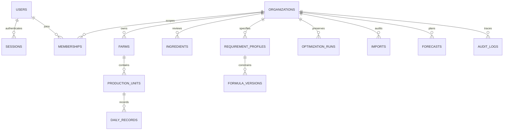

# Database architecture

## Foundation and stack decision
Next.js App Router, strict TypeScript and PostgreSQL. Development uses a local PostgreSQL container to permit real tenant-isolation tests without external accounts. SQL migrations are portable to Supabase PostgreSQL. The foundation uses server-side scrypt identity/session storage; Supabase Auth/Storage integration remains a deployment adapter, not a claim of configured Supabase services. Production adoption must choose managed Supabase Auth (migrate identity through reset/invite, not copy password hashes) or independently audit this identity implementation. No service-role key is exposed to the browser.

Identity: users(email normalized unique, password_hash, created_at), sessions(token_hash PK, user FK, expires_at). Organizations(id, name, currency, timezone); memberships(org,user composite PK, constrained role); farms(id,org,name,location,kind). Every operational query runs a transaction with a transaction-local `app.user_id`; a non-login `farm_app` role has no BYPASSRLS, cannot change schemas or identities, and uses membership RLS policies. Pool connections reset context at transaction end. Identity/session lookups use the server pool; operational SQL switches to farm_app. Security-definer membership helpers use fixed search_path, no caller-controlled SQL. Audit writes are part of the same transaction, audit reads are scoped; members cannot rewrite audit rows.

Owner/admin manage farms; manager can record/edit operations; worker records only permitted daily entries; auditor is read-only. Owner status is established atomically on organization creation, never by trusting a role submitted by the client. Membership management must prevent last-owner removal. Stable UUID keys; all timestamps timestamptz; currency ISO code; local dates stored as date; money numeric(20,4), quantities numeric(20,6).

## Domain model, phased
- organizations 1→N memberships/farms; users N→N organizations. Farm units → poultry houses/flocks/broiler batches/ponds. Composite (organization_id,id) references prevent cross-tenant parent assignment.
- production cycles own daily records, samples, mortality, health, treatments, transfers, partial harvests. Date/idempotency unique constraints stop duplicate entry; transfer pairs transactional.
- nutrient definitions include unit/basis/energy system/species; requirement profiles and restrictions are versioned. Ingredient composition, verification, laboratory sources and historical prices are separate versions, not destructive updates. Missing concentrations nullable; approved profiles immutable.
- feed formulas → versions → ingredient allocations + nutrient snapshots; optimizer runs store immutable inputs, solver version/status, results and residuals; batches reference approved version IDs.
- warehouses/items/lots/movements: immutable signed movements, reference idempotency, row locks for stock checks. Purchasing, receiving and stock usage distinct.
- suppliers/customers/purchase orders/sales/expenses/payments and balanced journal entries: transactions, immutable historical prices; corrections use reversals. No implicit doubling of receiving/expense events.
- forecasts → scenarios → versioned input/output snapshots separate from actuals. Imports → original object hash + staged rows/issues + confirmed normalized mapping. Tasks/notifications configurable; subscriptions/entitlements data-driven, payment collection disabled.

## Security and operations
Enable RLS and least-privilege grants on every tenant table, including new migrations. Test outsider reads and forged inserts/updates across tenants with the actual runtime role. Authorize every export and object download. Storage paths include organization IDs and explicit policies. Use non-public original workbook storage in production. Safe upload limits/type checking, no spreadsheet formula evaluation. Export CSV neutralizes leading =,+,-,@ user strings. Audit staff/organization/action/object and timestamp without credentials. Backups, retention, restore tests, TLS, connection pooling and migration rollback/recovery must be documented before production. Down migrations must never silently discard historical records.

## Implemented schema and permissions

Eighteen forward-only migrations currently create identities/sessions, organizations/memberships/farms/audit, imports/ingredients/reviewed requirements/formula versions/optimization runs, forecasts, production units and append-only daily records. They also add scientific context and inclusion limits, guarded team functions, organization settings and the restricted `farm_server` login. `farm_server` has NOINHERIT/NOSUPERUSER/NOBYPASSRLS and identity/session grants only; operational access requires `SET LOCAL ROLE farm_app`. Local migration/test-administration credentials are read only by setup/test helpers. Rollbacks for destructive historical tables are intentionally not automated; take and verify backups before schema changes.

Formula/forecast/import snapshots intentionally retain original input JSON alongside the relational tenant/identity graph; the expanded normalized nutrient and operational ledger entities above are still planned, not all implemented. Production record writes serialize per unit with a transaction advisory lock, reject mortality above current stock, require chronological unique dates and reject incomplete sampling pairs. Composite tenant-parent keys prevent cross-organization unit assignments. Operations and forecasts are not yet an integrated stock or financial ledger.

Migration 009 adds `import_reference_rows` with tenant/import composite ownership, immutable source fields/issues, hash/sheet/row/context uniqueness, and reader/editor RLS. `ingredients.parent_id` uses a composite tenant foreign key; revision sequencing is checked on insert and each parent can have only one successor. Runtime UPDATE access to ingredients is revoked, including for nutritionists. Review and price changes append new records, preserving recipe snapshots and their original IDs. These source candidates are separate from approved requirement profiles and are never applied automatically.

Migration 010 adds `formulation_drafts`, unique by `(organization_id, actor_id)`. RLS scopes reads/writes to the current actor with a current feed-editor membership; other administrators do not inherit access to private content. Column-level update grants prevent changing ownership, and a trigger checks revision increments. The API uses compare-and-swap updates and verifies every nonempty ingredient/profile/recipe reference against the organization. Save requests bind the browser's loaded actor identity to the authenticated session. Draft content has an explicit model version, omits approval status/results, and can represent incomplete editing states. It is never a released recipe or a financial/stock event. Saves record audit metadata without the private draft payload.

Migration 011 adds `workbook_uploads` with organization-scoped RLS, original bytea/hash, bounded inspection JSON, mapping/preview JSON, revision and confirmation state. Originals are shared only within their organization; the private formulation draft policy is unchanged. Only feed editors can upload/map/confirm. Column-level grants keep original bytes/hash/filename immutable, and a transition trigger locks confirmed jobs. Confirmations use a row lock and a unique `(upload_id,upload_row)` ingredient index; a composite tenant foreign key prevents attaching ingredient provenance to another organization's upload. Stored binaries require backup/storage planning; managed object storage can replace bytea behind the same authorized download contract later.

Migration 012 adds `requirement_profiles.parent_id/revision/ingredient_rules`. Parent IDs use a composite tenant foreign key; each version has at most one successor. All rule JSON is stored in the immutable parent row, preventing later child-rule insertion from changing historical semantics. Before-insert validation checks the current assigned nutritionist/reviewer, exact same-tenant approved ingredient UUIDs under RLS, compatible scientific context, distinct references, explicit bounds/evidence and simple inclusion feasibility. Runtime UPDATE/DELETE is not granted. API revision creation serializes by parent advisory lock; the unique successor index also protects direct concurrent inserts. No new tenant table or broader runtime grants are introduced. Rule UUIDs are validated by trigger rather than JSON foreign keys; runtime ingredient deletion/update remains unavailable. New recipe and optimization snapshots retain the exact profile/rules used.

Saved-recipe report/compare endpoints read `formula_versions` and immutable `requirement_profiles` in current-member RLS transactions. Comparisons fetch all requested IDs in one scoped query and reject any missing version before producing a response. Embedded historical profiles take precedence; older versions may resolve their immutable composite-tenant profile reference. Ingredient evidence comes exclusively from `ingredient_snapshot`, never the current ingredient table. New saved result JSON adds `savedBy` from the authenticated session; no migration or wider grants are introduced. Exports and comparisons are read-only and do not create financial, stock or manufacturing events.

Optimizer history uses the existing append-only `optimization_runs` RLS table. List queries project summary fields for the latest 100 records; detail queries scope both organization and UUID. Runtime UPDATE/DELETE remains unavailable. New request model 3 stores the same input/reference snapshots with richer result evidence and diagnostic model version 1. Before offering restoration, the API validates scenario structure and all ingredient/profile/cloned-recipe IDs against current same-organization visibility. Restored content is draft-only and follows the existing private CAS autosave path. Legacy raw records are available without rewriting or inventing missing evidence. No new migration or database grant is required.

Migration 013 adds `catalog_alias_reviews` with member SELECT and nutritionist-only INSERT RLS. Composite tenant foreign keys bind the immutable source row, exact ingredient revision and prior review; the trigger verifies eligible recipe/restriction categories, the authenticated reviewer and latest same-source lineage under an advisory transaction lock. Source/catalog and ingredient rows are not updated. Unique `(source_row_id, revision)` and one-successor constraints prevent forks. Runtime UPDATE/DELETE is unavailable. The API adds audit metadata in the same transaction and uses expected revisions to return a useful conflict before insertion. Identity decisions never grant scientific approval or change historical recipes/constraints. Read/export views display the latest 100 decisions while the database retains the complete chain.

Migration 014 adds before-insert validation of canonical nutrient composition/requirement JSON on the existing immutable ingredient/profile tables. It enforces numeric/null values, ordered explicit limits, percentage bounds and as-fed-only moisture. Historical rows are not rewritten or retrovalidated. The shared application registry supplies units/labels and distinguishes the seven original default-required fields from additional profile-assessed measurements. New saved recipe model 3 and optimizer request model 4 retain registry version 2/definitions; old report normalization retains its recorded nutrient set. No new tenant table, RLS policy or runtime grant is needed.

Migration 015 extends existing RLS-protected ingredient rows with nullable provenance and a before-insert date guard, leaving runtime UPDATE/DELETE unavailable. Immutable `formula_versions.source_recipe` stores complete source/review snapshots; a partial unique index on organization/preview digest makes confirmation idempotent. A before-insert trigger validates source ownership, unchanged fields/warnings, exact latest positive-row mappings, distinct allocations and draft-only semantics under ordered advisory review locks. API preview additionally verifies the complete 34-row catalog against the bundled immutable workbook audit and binds all evidence/reference/options in its checksum. Confirmation and audit share the same scoped transaction. No new tenant table or broader runtime privileges are introduced. Saved report normalization includes provenance only when recorded, preserving historical seven/eleven-field report evidence.

Migration 016 adds nullable paired `ingredients.processing_method/processing_evidence` and immutable `requirement_profiles.processing_rules` JSON. Insert guards validate at most twenty groups, exact closed-list members, same-tenant approved/context-compatible references, ordered explicit percentage bounds, unique names/members and any required recorded method. Existing reviewer/version triggers and RLS remain in force; no new table or broader grant is introduced. Optimizer request model 5 and recipe result model 4 snapshot the groups and independent compliance. Legacy report normalization omits empty group defaults and null processing fields to retain historical report bytes.

Optimizer comparisons use the existing `optimization_runs` member-read RLS in one transaction. All two-to-four requested UUIDs must be visible within the declared organization before any result/export is returned. Normalization reads embedded historical references/specifications only and checks solution/reference identity and historical objective/cost consistency. POST JSON and GET CSV/XLSX share deterministic normalized evidence; an SHA-256 identifies that comparison. There is no persisted comparison table, write, new grant or migration. Baseline/batch changes never update runs, formulations or inventory.

Saved PDF exports reuse `loadRecipeReports` inside the existing RLS transaction before rendering. The same normalized snapshot and digest feed PDF/CSV/XLSX; no new data, grant or mutation is introduced. Bundled font files are traced into the app's server function. The Node PDF renderer does not read current ingredient prices, evaluate user HTML or call the remote worker. Process-local concurrent generation and bounded document limits supplement the existing per-user export limiter.

Conflict diagnostics add metadata to immutable `optimization_runs.result` with request model 6/diagnostic model 3. The Node adapter maps bounded worker row/side indices to the exact original nutrient, processing and effective-bound identities; it validates response shape, uniqueness and completed-check counts. No diagnostic submodel allocation is stored. Existing same-tenant RLS/history/report queries expose recorded analysis to members/auditors without recomputing against current references. Legacy results remain unchanged; no migration or grant is required.

Layer reports read an existing layer unit, record prefix through the chosen end and optional forecast in one RLS-scoped SQL statement. No new tenant table or migration is needed. The API checks same-organization IDs and layer/egg-forecast types before deriving a bounded read-only snapshot. Decimal feed strings and immutable source IDs/timestamps are retained; stable input/source/result evidence is hashed, with generation time outside the digest. Reports/downloads do not append records, forecasts, audits or inventory movements. An appended record outside the report end cannot alter its source snapshot.

Migration 017 adds append-only layer review chains for full daily replacements/backfills and opening-of-day censuses. Composite tenant/unit/date/kind predecessor FKs, unique roots/successors, per-unit advisory locks and exact original-record checks protect source lineage. RLS limits review inserts to owner/admin/manager with the current actor/time; members/auditors can read. Security-invoker views apply only the latest full replacement and expose recorded balances, without granting direct farm_server access. Each census segment independently validates recorded losses; ordinary daily inserts share the same lock and effective balance. The API pairs review/audit writes, checks optimistic predecessors and uses immutable request receipts for exact idempotent retries. Original records and all earlier reviews remain immutable. Censuses do not attribute population discrepancies or fill missing production observations, and no stock/financial event is inferred.

Migration 018 introduces immutable egg stores, source/opening batches and stock/sale events. Composite tenant/store/batch/unit/receipt/reversal FKs, exact original-source snapshots, unique collection batches/receipt chains/sale references/reversals and insert-only RLS protect lineage. Security-invoker movement/balance views preserve whole-egg grade conservation. Every posting takes the same organization advisory lock and allocates order inside it; collection receipts also share the production-unit lock. Database triggers independently enforce current source/receipt evidence, whole-egg pricing, original reversal values, date order, nonnegative stock and physical-count optimistic positions. Deferred initial-event checks prevent unconfirmed batches. Opening-of-day store baselines precede operations and exclude earlier collection receipts. The API pairs stock/audit transactions and exact retry receipts. Sales values remain separate from the planned balanced financial ledger; inter-store transfers, partial returns and historical as-of queries are not implemented here.
